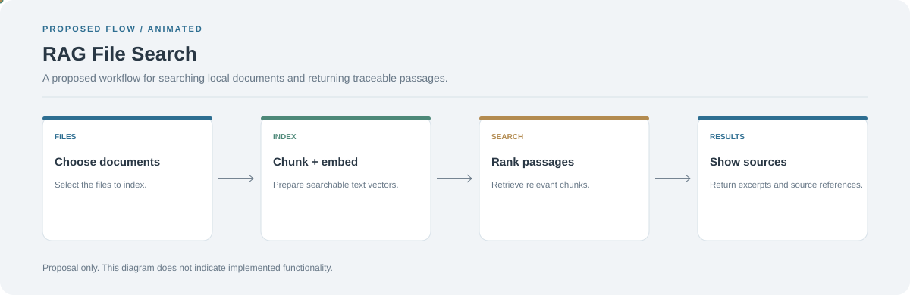

# RAG File Search

**A proposed workflow for searching local documents and returning traceable passages.**

[](https://github.com/chyk2468/Retrieval-Augmented-Generation-File-Search)

## 1. Project Title & Tagline

A proposed workflow for searching local documents and returning traceable passages.

## 2. Problem Statement

Finding the right information across many files is slow when users must open documents one by one. A retrieval workflow can index text and return relevant passages for a query.

## 3. Project Preview

No application screenshot is available yet. Add one after the first working document-search flow is implemented.

[Open interactive architecture](architecture.html)

## 4. Overview

**Status: proposal only.** The stages below describe a possible implementation and do not represent existing features.

## 5. Key Features

- Planned file ingestion and text extraction.
- Planned chunking and embedding.
- Planned similarity search.
- Planned source excerpts and grounded responses.

## 6. Architecture / Workflow



Open the [interactive architecture explorer](architecture.html) to inspect each proposed stage.

## 7. Tech Stack

Not implemented yet. A possible baseline is Python, local embeddings, a vector index, and a simple UI.

## 8. Installation & Setup

```bash
git clone https://github.com/chyk2468/Retrieval-Augmented-Generation-File-Search.git
cd Retrieval-Augmented-Generation-File-Search
```

The repository currently has no runnable search application.

## 9. Usage

This is a design proposal, not a working tool. Start by implementing a tested document loader and a query that returns source excerpts.

## 10. Project Structure

Proposed layout: `src/`, `tests/`, `data/`, `README.md`, and a dependency file.

## 11. Results & Demo

No implementation results are available yet because the repository is a placeholder.

## 12. Future Enhancements

- Implement document loading and tests.
- Add chunking and local embeddings.
- Build a searchable index.
- Return source paths and excerpts with each result.

## 13. License

Add a LICENSE file before granting reuse or redistribution permissions.
