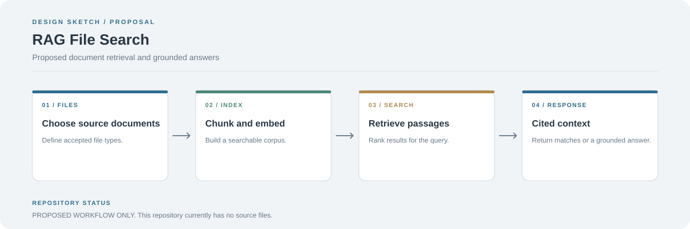

# Retrieval-Augmented Generation File Search

This repository is currently empty. There is no working search service, embedding pipeline, or user interface to run at this stage.

## Proposed architecture

1. Ingest selected files and extract their text.
2. Split the text into chunks and create embeddings.
3. Store chunk text, source paths, and vectors in an index.
4. Embed a user's query and retrieve the most relevant chunks.
5. Return matched passages, source references, or a grounded response.

## Suggested implementation order

- Add a basic document loader and tests.
- Implement chunking and local embedding.
- Add a vector index and similarity search.
- Return source paths and excerpts with every result.
- Add a UI only after the retrieval pipeline works.

The diagram is a design proposal, not a description of existing features.
